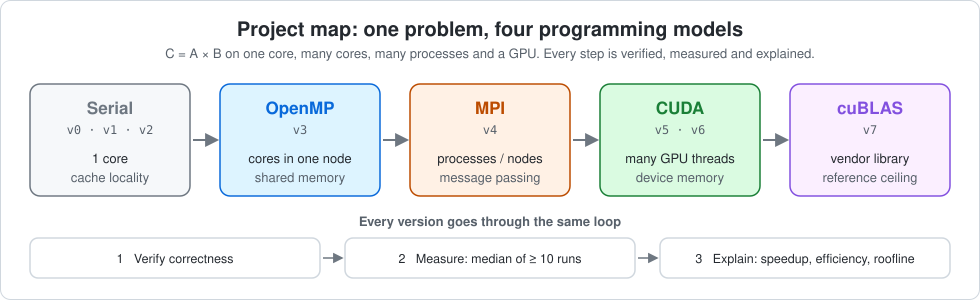
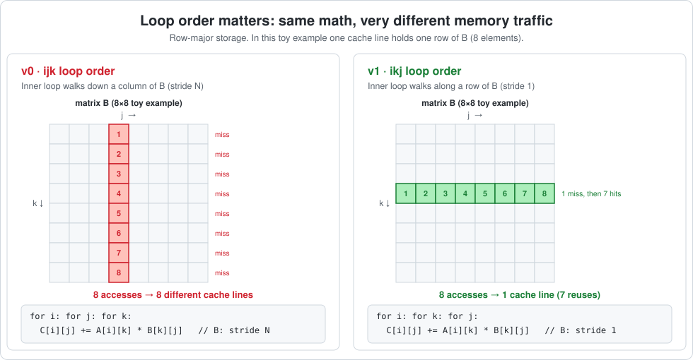
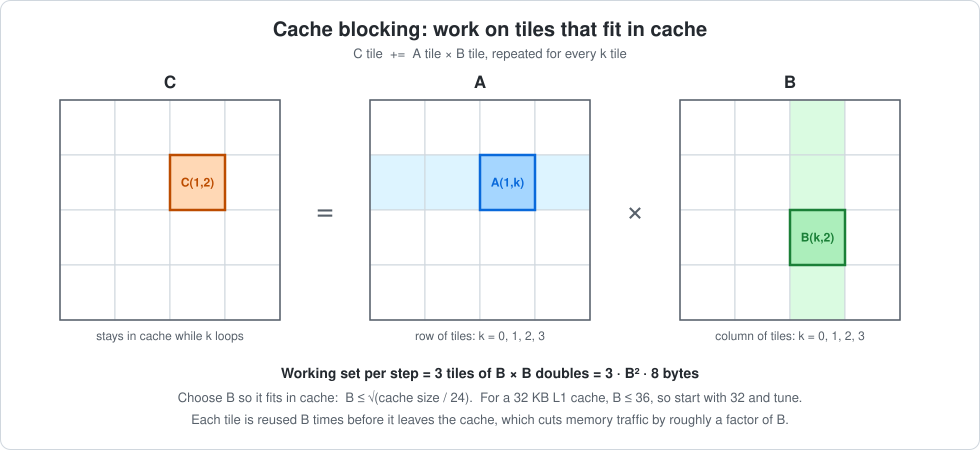
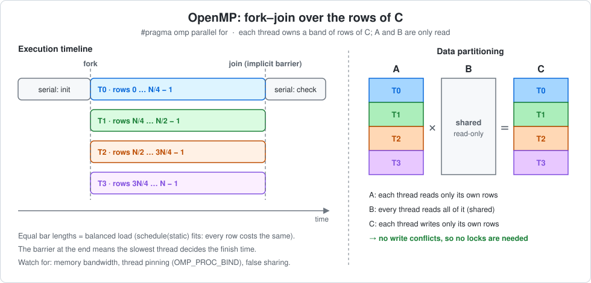
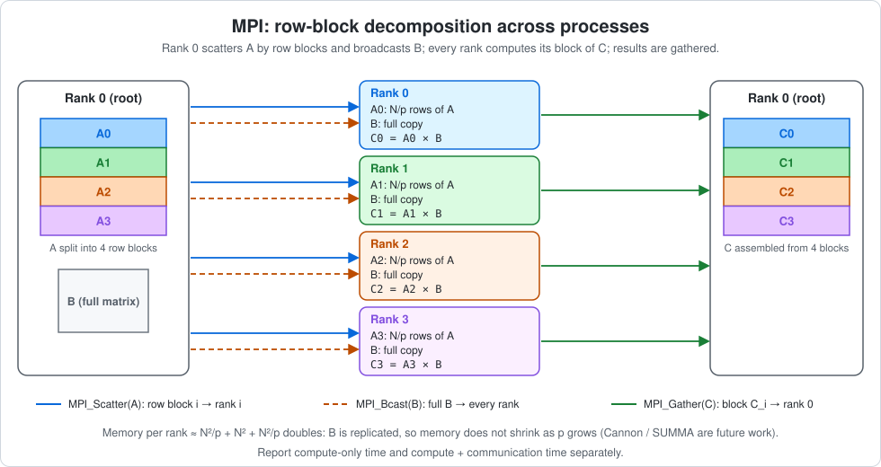
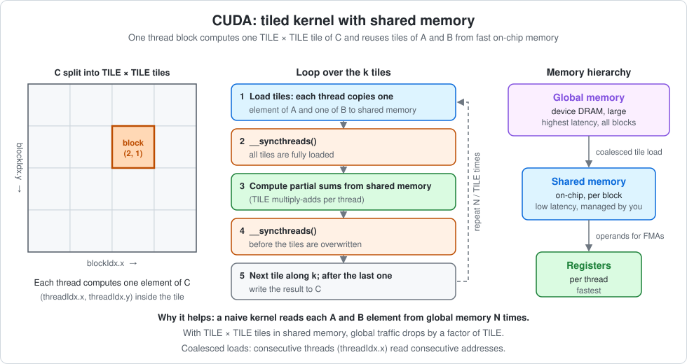
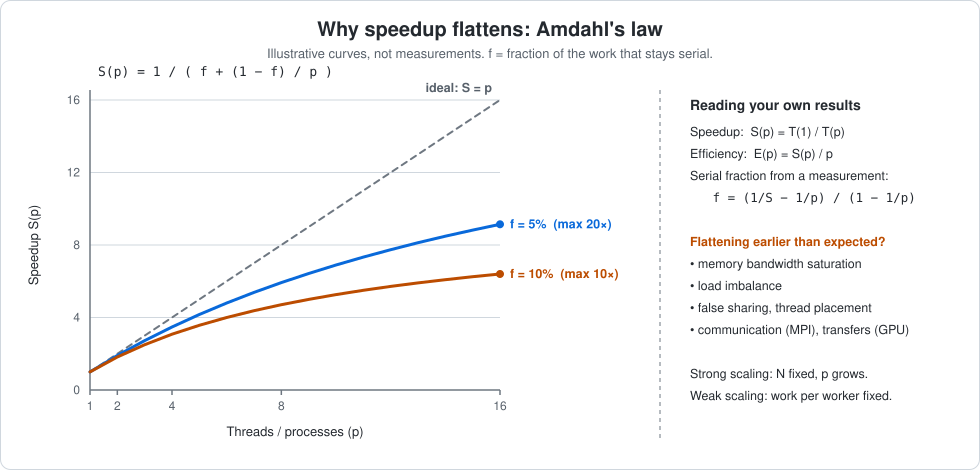
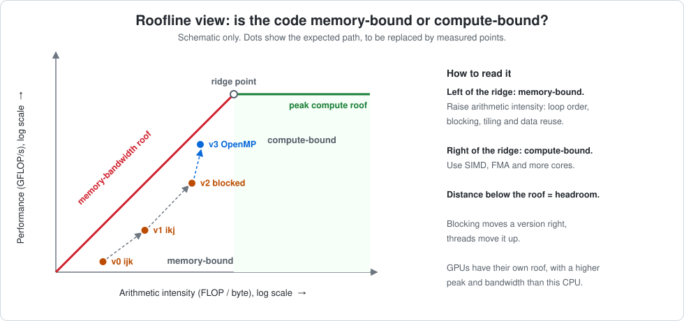

# HPC MatMul Lab: Matrix Multiplication from Serial to OpenMP, MPI and CUDA
 


 
A hands-on, self-study project in which I implement **dense matrix multiplication (C = A × B)** with the main parallel programming models, then **measure, compare and explain** the performance of each one.
 
The goal is not only to make it faster. The goal is to understand **why** it is faster (or not): memory access patterns, cache behaviour, communication overhead, load balance and the limits of scaling.
 
> **Status:** in active development. The [Roadmap](#roadmap) shows what is done and what is next. Every number in this README comes from a real run; anything not yet measured is marked `TBD`.
 
<p align="center">
  
</p>
**Contents:** [Motivation](#motivation) · [Implementations](#implementations) · [Concepts at a glance](#concepts-at-a-glance) · [Repository structure](#repository-structure) · [Build and run](#build-and-run) · [Benchmark methodology](#benchmark-methodology) · [Results](#results) · [Analysis](#analysis) · [Roadmap](#roadmap) · [Learning goals](#learning-goals) · [References](#references) · [Author](#author)
 
---
 
## Motivation
 
My background is in **backend engineering, DevOps and performance testing**: load testing with k6, fault injection, distributed tracing and bottleneck analysis. I wanted to apply the same *measure first, hypothesize, verify* discipline at the hardware level:
 
1. Establish a correct baseline.
2. Measure it properly (warm-up, repeated runs, stable statistics).
3. Optimize one thing at a time.
4. Explain every speedup, and every failure to speed up, with evidence.
Matrix multiplication is a good vehicle for this. It is simple to state and compute-heavy (O(N³) work on O(N²) data), and it is sensitive to every layer of the machine: cache, vectorization, threads, network and GPU memory hierarchy.
 
---
 
## Implementations
 
| Version | Model | What it demonstrates |
|---|---|---|
| `v0_serial_ijk` | Serial | Naive triple loop; the correctness reference |
| `v1_serial_ikj` | Serial | Loop reordering for cache-friendly, row-major access |
| `v2_serial_blocked` | Serial | Cache blocking (tiling) |
| `v3_openmp` | OpenMP | Shared memory: `parallel for`, scheduling, `collapse`, SIMD |
| `v4_mpi` | MPI | Distributed memory: row-block decomposition with `Scatter` / `Bcast` / `Gather` |
| `v5_cuda_naive` | CUDA | One thread per output element, global memory only |
| `v6_cuda_tiled` | CUDA | Shared-memory tiling with coalesced access |
| `v7_cublas` | cuBLAS | Vendor-optimized reference point for comparison |
 
**Planned extensions:** hybrid MPI + OpenMP, and a multithreaded version (`std::thread` / pthreads) to compare against OpenMP.
 
**Design decisions**
 
- Data type: double precision (FP64) by default, so CPU and GPU results are directly comparable.
- Matrices are stored in row-major order as flat arrays.
- Inputs are generated from a fixed random seed, so every run is reproducible.
---
 
## Concepts at a glance
 
The diagrams below explain the idea behind each version. They are conceptual illustrations, not measurements; real numbers appear in [Results](#results) once they have been measured.
 
### Serial: loop order and cache blocking
 
The same triple loop can touch memory in very different patterns. Reordering `ijk` to `ikj` makes the innermost loop read `B` along a row (stride 1) instead of down a column, so each cache line is fully used. Blocking then keeps small tiles of `A`, `B` and `C` resident in cache while they are reused.
 
<p align="center">
  
</p>
<p align="center">
  
</p>
### OpenMP: shared-memory parallelism
 
The outer loop over rows of `C` is split among threads. Every thread reads the shared `B` and writes only its own rows of `C`, so no locks are needed. Performance is then limited by load balance, memory bandwidth and thread placement.
 
<p align="center">
  
</p>
### MPI: distributed-memory parallelism
 
Rank 0 scatters row blocks of `A`, broadcasts `B`, every rank computes its block of `C`, and the blocks are gathered back. Communication is explicit, so its cost must be measured separately from computation.
 
<p align="center">
  
</p>
### CUDA: tiling through shared memory
 
Each thread block computes one tile of `C`. Threads cooperatively stage tiles of `A` and `B` into shared memory, synchronize, compute partial sums, and move on to the next tile, which cuts global-memory traffic by a factor of the tile size.
 
<p align="center">
  
</p>
---
 
## Repository structure
 
```
hpc-matmul-lab/
├── src/
│   ├── serial/            # v0, v1, v2
│   ├── openmp/            # v3
│   ├── mpi/               # v4
│   ├── cuda/              # v5, v6, v7
│   └── common/            # matrix init, timing, verification utilities
├── scripts/
│   ├── run_benchmarks.sh  # runs all versions over sizes / thread counts
│   └── plot_results.py    # speedup, efficiency and GFLOP/s plots
├── results/
│   ├── raw/               # CSV output of every run
│   └── plots/             # generated figures
├── docs/
│   ├── analysis.md        # detailed performance analysis
│   └── images/            # SVG diagrams used in this README
├── Makefile
├── LICENSE
└── README.md
```
 
---
 
## Build and run
 
**Requirements**
 
- A C/C++17 compiler with OpenMP support (GCC 9 or newer, or Clang)
- An MPI implementation (Open MPI or MPICH)
- CUDA Toolkit 11 or newer, for the GPU versions
- Python 3 with `matplotlib` and `pandas`, for the plots
**Build**
 
```bash
make all        # everything
make serial     # one model at a time
make openmp
make mpi
make cuda
make clean
```
 
Suggested flags: `gcc -O3 -march=native -fopenmp` for CPU code and `nvcc -O3 -arch=sm_XX` for CUDA (set `sm_XX` to your GPU's compute capability).
 
**Run**
 
```bash
./bin/matmul_serial 1024                      # serial
OMP_NUM_THREADS=4 ./bin/matmul_openmp 1024    # OpenMP, 4 threads
mpirun -np 4 ./bin/matmul_mpi 1024            # MPI, 4 processes
./bin/matmul_cuda 1024                        # CUDA
```
 
Every executable takes the matrix size `N` and prints the correctness result, the median time and the GFLOP/s.
 
**Run the full benchmark suite and generate plots**
 
```bash
./scripts/run_benchmarks.sh
python3 scripts/plot_results.py
```
 
---
 
## Benchmark methodology
 
Performance claims are only useful if the measurement is trustworthy, so every version follows the same rules:
 
- **Correctness first.** Each result is checked against the serial reference using a relative tolerance. A fast wrong answer is discarded.
- **Warm-up run** before timing (caches, page faults, GPU context initialization).
- **Repeated runs** (at least 10). I report the **median** and keep min, max and standard deviation in the raw CSV.
- **Computation-only timing** by default. For MPI and CUDA I also report a second time that includes data distribution and host-device transfers, because ignoring communication cost hides the real picture.
- **Pinned thread placement** for OpenMP (`OMP_PROC_BIND`, `OMP_PLACES`) to avoid noise from thread migration.
- **Fixed environment**, recorded for every run (see [Test environment](#test-environment)).
### Metrics
 
| Metric | Definition |
|---|---|
| Throughput | `GFLOP/s = 2·N³ / (time · 10⁹)` |
| Speedup | `S(p) = T(1) / T(p)` |
| Parallel efficiency | `E(p) = S(p) / p` |
| Strong scaling | Fixed problem size, increasing number of workers |
| Weak scaling | Work per worker kept constant (N grows as p^(1/3)) |
| Amdahl's law | Used to estimate the serial fraction from measured speedup |
 
The curves below show what Amdahl's law predicts for a given serial fraction `f`. They are illustrative; my measured speedups will be compared against this shape.
 
<p align="center">
  
</p>
---
 
## Results
 
> Numbers are filled in from real runs only. Entries marked `TBD` have not been measured yet.
 
### Test environment
 
| Item | Value |
|---|---|
| CPU | TBD (model, cores, threads, cache sizes) |
| RAM | TBD |
| GPU | TBD (model, SMs, memory) |
| OS | TBD |
| Compiler and flags | TBD (for example `gcc -O3 -march=native -fopenmp`) |
| MPI / CUDA versions | TBD |
 
### Single-node comparison (N = 2048)
 
| Version | Time (s) | GFLOP/s | Speedup vs v0 |
|---|---|---|---|
| v0 serial ijk | TBD | TBD | 1.0× |
| v1 serial ikj | TBD | TBD | TBD |
| v2 serial blocked | TBD | TBD | TBD |
| v3 OpenMP (max threads) | TBD | TBD | TBD |
| v4 MPI (max processes) | TBD | TBD | TBD |
| v5 CUDA naive | TBD | TBD | TBD |
| v6 CUDA tiled | TBD | TBD | TBD |
| v7 cuBLAS | TBD | TBD | TBD |
 
### OpenMP strong scaling (N = 2048)
 
| Threads | Time (s) | Speedup | Efficiency |
|---|---|---|---|
| 1 | TBD | 1.00 | 100% |
| 2 | TBD | TBD | TBD |
| 4 | TBD | TBD | TBD |
| 8 | TBD | TBD | TBD |
 
### Plots
 
Generated by `scripts/plot_results.py` into `results/plots/`:
 
- Speedup vs threads, against the ideal linear line
- Parallel efficiency vs threads
- GFLOP/s vs matrix size, for every version
---
 
## Analysis
 
The detailed write-up lives in [`docs/analysis.md`](docs/analysis.md) and will be completed with measured data. Each section answers one question with evidence:
 
1. **Loop order:** why does `ikj` beat `ijk` on a single core? (cache lines, stride-1 access, hardware prefetching)
2. **Blocking:** which block size is best, and how does it relate to L1/L2 cache size?
3. **OpenMP:** where does scaling flatten? Is it memory bandwidth, hyper-threading, false sharing or scheduling? What is the effect of `static` vs `dynamic`?
4. **MPI:** how much time goes to communication compared with computation? At what size does distribution stop paying off?
5. **CUDA:** how much does shared-memory tiling help over the naive kernel? How close does it get to cuBLAS, and what explains the gap?
6. **Roofline view:** is each version compute-bound or memory-bound, and how far is it from peak?
For the roofline question, the schematic below shows the expected path of the CPU versions. Each dot will be replaced by a measured point (from `perf` and hardware counters) once the data exists.
 
<p align="center">
  
</p>
**Known limitations (to be addressed)**
 
- The first MPI version assumes N is divisible by the number of processes; `Scatterv` / `Gatherv` will handle the remainder case.
- Results depend on the specific hardware listed in the test environment and should not be generalized to other machines.
---
 
## Roadmap
 
- [x] Project setup and repository structure
- [ ] Common utilities: matrix init, verification, timer
- [ ] v0 serial baseline and correctness checker
- [ ] v1 / v2 serial optimizations (loop order, blocking)
- [ ] v3 OpenMP and strong-scaling experiment
- [ ] Benchmark script and plotting
- [ ] First results and analysis in this README
- [ ] v4 MPI (row-block decomposition)
- [ ] v5 / v6 CUDA kernels
- [ ] v7 cuBLAS comparison
- [ ] Hybrid MPI + OpenMP
- [ ] Profiling with `perf`, `nsys` and `ncu`, and a roofline plot
- [ ] Weak-scaling study
---
 
## Learning goals
 
- Understand how the memory hierarchy, more than arithmetic, usually decides CPU performance.
- Reason about shared vs distributed memory and the cost of communication.
- Map a problem onto the GPU execution model (grids, blocks, warps, shared memory).
- Design honest, reproducible benchmarks and interpret scaling results correctly.
---
 
## References
 
- Hennessy, J. and Patterson, D. *Computer Architecture: A Quantitative Approach*.
- Pacheco, P. *An Introduction to Parallel Programming*.
- Kirk, D. and Hwu, W. *Programming Massively Parallel Processors*.
- Williams, S., Waterman, A. and Patterson, D. *Roofline: An Insightful Visual Performance Model for Multicore Architectures*. Communications of the ACM, 2009.
- Official OpenMP, MPI and CUDA documentation.
---
 
## Author
 
**Abdulrahman Fikry Ahmed Farag Albadry**
Computer Science graduate, Tanta University (2026). Backend and DevOps engineer with open-source contributions; self-studying parallel programming and performance engineering in preparation for graduate studies in High-Performance Computing.
 
[GitHub](https://github.com/abdulrahman11a) · [LinkedIn](https://www.linkedin.com/in/abdulrahman-fikry-7787392a6) · abdulrahmanfikry1@gmail.com
 
## License
 
MIT. See [LICENSE](LICENSE).
